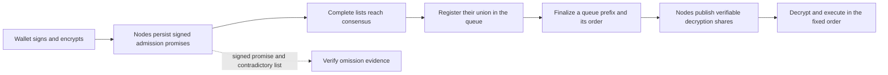

# Pinocchio

**English** | [简体中文](README.zh-CN.md)

**Make promises checkable. Make markets replayable.**

Pinocchio is a Go research prototype for encrypted order admission, processing, and node accountability. **v0.3 runs a complete local protocol across independent processes**, using CometBFT consensus and real Shutter threshold encryption. The earlier single-process simulation remains available for controlled scenarios.

## Why Pinocchio?

Network delay can give nodes different views of transaction arrival. Different views alone do not prove dishonesty. A signed admission promise followed by the same node's signed complete list omitting that order can, however, provide evidence of a rule violation.

We want these contradictions to be visible, like Pinocchio's nose. The project checks statements and rules; it does not infer a node's motives or prove the real-world time at which it first received an order.

## What runs today?

| Mode | Implemented components | Purpose |
|---|---|---|
| **v0.3 `network`** | Separate node processes and durable state; CometBFT v0.38.26; Shutter shlib v0.1.19 threshold encryption; signed promises, registration, queue locks, share release, execution, and omission evidence | Exercise the protocol with actual consensus and cryptographic operations |
| **v0.2 simulation** | Virtual message scheduling; real signatures and AES-GCM; ideal finality and key vault; artifact audit and semantic replay | Reproduce controlled delay, corruption, duplicate, and omission scenarios |

The default live network has five equal-power validators, tolerates one Byzantine validator under the consensus assumptions, requires four admission signatures, and decrypts with three distinct valid shares. Each running node holds its own signing key and threshold secret share.

### Follow an order



Alice can submit a YES purchase after seeing a match result. Encryption hides her order contents until its service order is locked. Admission promises give nodes an explicit, checkable inclusion obligation. These protections do not guarantee a fill, a profit, or priority over everybody who learned the result later.

## Run the local protocol

Prerequisites: Go >=1.23 and a working C compiler for the cryptographic dependency. The first build downloads Go modules. Run from the repository root:

```sh
./scripts/network-demo.sh runs/my-v03-test offline
```

The script builds the executable, initializes a new network, starts five node processes, stops the fifth validator, and submits three purchases. The remaining four validators register, lock, decrypt, and process the orders. An auditor checks signed consensus commits, replays committed blocks, verifies threshold openings, and independently recomputes market accounting. The script stops its node processes on exit.

Use a **new output directory** for every run. Inspect `runs/my-v03-test/audit.json`, the three `*-receipt.json` files, and `node*.log`. The network directory also contains private demo keys; keep it out of Git.

Other script modes are `normal`, `omission`, and `withhold`. See the [live protocol guide](docs/LIVE_PROTOCOL.md) or [中文协议与操作说明](docs/LIVE_PROTOCOL.zh-CN.md) for manual node operation and exact fault behavior.

## Validation and limits

The actual process integration test has passed: a promise signer restarts with the same durable promise; four validators continue with one offline; the returning node catches up without duplicate execution; and a signed omission produces evidence while the order is still processed. Unit tests and `go vet` also pass. These are functional checks, **not a performance benchmark or security proof**.

Important deployment boundaries:

- The initializer runs real per-party DKG calculations through a local relay, but can access all resulting shares while provisioning. This is not an independently deployed, authenticated distributed DKG ceremony.
- Processes run on the same machine and under the same OS user. They are separate protocol participants, not separate security domains. APIs bind to loopback.
- Within-round sorting is a deterministic placeholder, not arrival-time fairness or Condorcet ordering.
- Evidence is recorded; gas, deposits, economic penalties, and buyer-funds reservation are not implemented.
- Enough colluding share holders can reveal orders early. Missing consensus quorum or decryption shares can stop progress.
- No external settlement, production prediction-market infrastructure, established novelty claim, or complete MEV protection is provided.

## Keep the simulation baseline

```sh
./scripts/go.sh test ./...
./scripts/go.sh run ./cmd/pinocchio run -scenario normal -out runs/sim-normal-01
./scripts/go.sh run ./cmd/pinocchio run -scenario omission -out runs/sim-omission-01
./scripts/go.sh run ./cmd/pinocchio audit -file runs/sim-omission-01/report.json
```

The `run`, `audit`, and `replay` simulation commands are described in the [v0.2 prototype guide](docs/PROTOTYPE.md). They do not start the live network.

## Documentation

### Experimental median ordering and measurements

Use `network init -ordering median-receipts` for signed local admission observations and experimental median-based ordering. Sparse observations explicitly fall back to identity order after qualified items; this is **not a full AOAB implementation or an inherited fairness guarantee**. The default `identity` policy remains available.

```sh
./scripts/ordering-experiment.sh runs/ordering-normal-01 normal 1
```

This runs both policies through actual local validator processes, records phase observations and completion counts, and audits the committed chain and market accounting. See the [experiment guide](docs/ORDERING_EXPERIMENTS.zh-CN.md) for faults, repetitions, and measurement limits.

- [Live protocol and commands](docs/LIVE_PROTOCOL.md) · [中文版](docs/LIVE_PROTOCOL.zh-CN.md)
- [Design scope](docs/SCOPE.md) · [Roadmap](ROADMAP.md)
- [Development report](docs/DEVELOPMENT_REPORT.zh-CN.md)
- [Go learning and maintenance guide](docs/LEARNING.zh-CN.md)
- [GitHub beginner guide](docs/GITHUB_GUIDE.zh-CN.md)
- [v0.3 validation record](docs/validation-v03.json) · [v0.2 validation record](docs/validation-v02.json)

## Related work and dependencies

Existing mechanisms are attributed to their sources; combining them does not establish novelty.

- [Shutter + Primev public design](https://ethresear.ch/t/threshold-encrypted-mempools-with-mev-commit-preconfirmations/23588) and [primev-sequencer](https://github.com/shutter-network/primev-sequencer): encrypted transactions and inclusion commitments.
- [Shutter shlib](https://github.com/shutter-network/shutter/tree/main/shlib) and [Rolling Shutter](https://github.com/shutter-network/rolling-shutter): threshold-encryption components and infrastructure.
- [CometBFT](https://github.com/cometbft/cometbft): the live mode's consensus engine.
- [AOAB](https://gramoli.github.io/pubs/DSN24_AOAB_preprint.pdf): ordering, common output, and inclusion guarantees.
- [PeerReview](https://www.sigops.org/s/conferences/sosp/2007/papers/sosp118-haeberlen.pdf): signed logs and accountability.
- [ABIDES](https://github.com/abides-sim/abides): market and message-delay simulation.

## License

A license for this project's own code has not been selected. Third-party dependencies retain their licenses; see [attribution](THIRD_PARTY.md) and [threshold-component notices](threshold/THIRD_PARTY.md).

## Python harness / 模型接入

`python3 harness/pinocchio_harness.py --binary bin/pinocchio --run-dir runs/model-session-01`

Control local validators, faults, measurements and audits through validated JSONL tools or a Python model adapter. 详见[Python 节点控制与模型接入](docs/PYTHON_HARNESS.zh-CN.md)。
