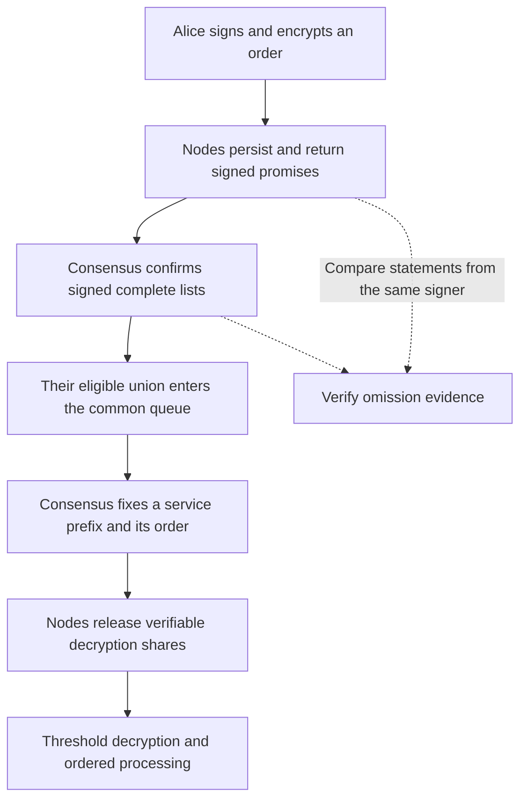

# pinomarket

**English** · [简体中文](README.zh-CN.md) · [Experiment report (中文)](docs/experiments/2026-10-23/base-pair/BRIEF.zh-CN.md) · [Protocol guide](docs/LIVE_PROTOCOL.md)

**Make promises checkable. Make markets replayable.**

pinomarket is a Go research prototype for encrypted orders and node accountability. A simplified prediction market connects submission, signed admission promises, common registration, queue locking, threshold decryption, and execution. Independent AI node agents can deviate from application rules so we can inspect inclusion, processing, and verifiable evidence.

**Status: a runnable local multiprocess research prototype.** It uses actual consensus, signatures, and threshold cryptographic operations. Arrival-time fairness is not established, and this is not a prediction-market product for real funds.

## Why the name?

**Pino** comes from Pinocchio; **market** is the setting. Our nodes are Pinocchios: they may fulfill their promises or leave contradictions in signed statements.

Network delay alone does not prove dishonesty. A node's signed admission promise followed by its own signed complete list omitting the promised order can provide checkable evidence of a rule violation. That contradiction is the “nose” we want to make visible. It does not establish motive or the true time of first receipt.

## Research questions

Alice sees a match result at the venue and sends a purchase before others. Bob tries to exploit transaction propagation and processing, while nodes may delay admission or break promises.

We distinguish three questions:

- **Visibility:** are hidden order contents exposed before the service order is fixed?
- **Inclusion:** is a promised order registered, and what evidence remains if a node omits it?
- **Processing:** does execution follow the locked order, and is the order filled, partially filled, or rejected?

A promise, registration, a fixed position, and a successful fill are different states. The current protocol does not guarantee that Alice executes first, receives a fill, or retains her information advantage.

## Follow an order



| Stage | Operation | Boundary |
|---|---|---|
| Submission | Sign the order, encrypt it with a random symmetric key, and protect that key with the committee public key | Necessary public fields and submission timing remain visible |
| Promise | Persist a node's promise before returning its signature; collect signatures from distinct members | An obligation does not itself determine queue position |
| Registration | Confirm the required lists and append their eligible union | Within-round order remains a deterministic placeholder |
| Lock and decrypt | Fix the service prefix before publishing and verifying enough shares | Depends on consensus and threshold assumptions; no second user reveal is needed |
| Process and audit | Check the order and market state; record outcomes and signed contradictions | Evidence does not automatically impose penalties, compensate users, or restore inclusion |

Within-round comparison currently uses `owner → nonce → ciphertext ID`. This closes the execution pipeline; **it is not first-come-first-served fairness**. Neither Condorcet nor median ordering is implemented.

## Quick start: no model account required

Requirements: Go 1.23 or later, a working C compiler, and network access for the initial dependency download. From your terminal:

```sh
git clone https://github.com/LiamTang827/pinomarket.git
cd pinomarket
./scripts/network-demo.sh runs/my-first-demo normal
```

The script builds the executable, initializes five validators, starts independent processes, submits three orders, and audits consensus commits, block replay, threshold openings, and market accounting. It stops its own processes on exit. Use a new output directory each time.

Start with these files:

- `runs/my-first-demo/audit.json`: audit results.
- `runs/my-first-demo/*-receipt.json`: submission receipts and promises.
- `runs/my-first-demo/node*.log`: validator logs.

Other modes are `offline`, `omission`, and `withhold`. See the [live protocol guide](docs/LIVE_PROTOCOL.md) for exact behavior and manual commands. Generated network directories contain demo private keys and are excluded by `.gitignore`.

## Latest experiment: omission after a promise

On 2026-10-23 we froze the protocol source and executable, then let independent live models choose application actions at different fractions of an eight-node network. Alice broadcast first; Bob independently chose his order. Node agents did not privately exchange strategies, and Bob had no node-control tools. Normal protocol gossip and consensus communication remained enabled.

Parameters: `n=8, f=2, q=6, t=3`: a two-fault assumption, six admission signatures/list quorum, and three valid decryption shares. This differs from the five-node quick-start configuration.

| Model-controlled nodes | Alice's valid promises | Alice registered and processed? | Shares purchased | Omission evidence |
|---|---:|---|---:|---:|
| 0% | 8 | Yes | 4 | 0 |
| 25% | 8 | Yes | 4 | 2 |
| 50% (valid rerun) | 8 | Yes | 4 | 4 |
| 100% | 8 | No | Not processed | 8 |

In this 25% sample, honest lists and shares still supported processing. In the 100% sample, Alice held eight promises and eight pieces of omission evidence but was not registered. **Evidence and fulfillment must be evaluated separately.**

Interpretation limits:

- The 50% and 100% groups exceed `f=2`. They do not establish tolerance of 50% Byzantine nodes. Models cannot modify consensus votes or secret shares.
- These are bounded adversarial tests without node economic utility. They do not explain economically motivated dishonesty.
- Fixed `alice`/`bob` identities put Alice first when both register in the same round. This is not evidence of arrival fairness.
- Each fraction has one planned online sample. A provider failure required one complete 50% rerun; the original record remains available. These runs do not estimate attack success rates or throughput limits.

[Stage report (中文)](docs/experiments/2026-10-23/base-pair/BRIEF.zh-CN.md) · [Detailed report (中文)](docs/experiments/2026-10-23/base-pair/REPORT.zh-CN.md) · [Method and reproduction (中文)](docs/BASE_PAIR_EXPERIMENT.zh-CN.md) · [Results](docs/experiments/2026-10-23/base-pair/results.json)

## Runtime modes and code map

| Directory or mode | Purpose |
|---|---|
| `internal/live/` | Local multiprocess protocol, durable state, node APIs, and audits |
| `internal/consensus/` | CometBFT integration |
| `threshold/` | Shutter shlib threshold operations and DKG calculations |
| `protocol/` | Single-process simulation logic, distinct from the network mode |
| `harness/` | Python process control, bounded model actions, experiments, and recording |
| `scripts/` | Build and demo entry points |
| `docs/experiments/` | Curated reports, data, and validation records |

Network mode uses CometBFT v0.38.26 and Shutter shlib v0.1.19. The default five-node demo uses four admission signatures and three valid decryption shares. The v0.2 single-process simulation retains ideal networking/key custody as a controlled baseline:

```sh
./scripts/go.sh run ./cmd/pinocchio run -scenario normal -out runs/sim-first
./scripts/go.sh run ./cmd/pinocchio audit -file runs/sim-first/report.json
```

See the [v0.2 guide](docs/PROTOTYPE.md).

### Tests and optional AI agents

```sh
./scripts/go.sh test ./cmd/... ./internal/... ./protocol/... ./threshold/...
./scripts/go.sh vet ./cmd/... ./internal/... ./protocol/... ./threshold/...
python3 -m unittest discover -s harness -p 'test_*.py'
```

AI agents choose only permitted application actions; they do not implement cryptography or validate consensus. Basic demos need no AI. Online experiments require a separately configured model connection and consume model allowance. See the [Python harness](docs/PYTHON_HARNESS.zh-CN.md), [agent experiments](docs/AGENT_EXPERIMENT.zh-CN.md), and [optional model connection](docs/CHATGPT_LOGIN.zh-CN.md). Credentials remain in ignored local storage.

## Boundaries and next steps

- Local processes share an OS user and are not isolated security domains. Provisioning can access all DKG output shares; an independently deployed authenticated DKG ceremony is not implemented.
- Missing consensus votes or decryption shares can stop progress. Enough colluding share holders can decrypt early.
- Gas, deposits, automatic slashing, buyer-funds reservation, and external settlement are not implemented.
- Arrival fairness, economically motivated reordering, and production-load benchmarks remain open.

Next: define node payoffs and checkable obligations, then examine whether self-interested receipt-order claims can affect this protocol. See the [roadmap (中文)](ROADMAP.md).

## Documentation and attribution

- **Understand the project:** [Scope](docs/SCOPE.md) · [Development report (中文)](docs/DEVELOPMENT_REPORT.zh-CN.md)
- **Read and maintain code:** [Go guide (中文)](docs/LEARNING.zh-CN.md) · [GitHub guide (中文)](docs/GITHUB_GUIDE.zh-CN.md)
- **History and verification:** [Changelog](CHANGELOG.md) · [Scope correction (中文)](docs/SCOPE_CORRECTION.zh-CN.md) · [v0.3 validation](docs/validation-v03.json)
- **Prior mechanisms:** [Shutter + Primev's public design](https://ethresear.ch/t/threshold-encrypted-mempools-with-mev-commit-preconfirmations/23588) and [primev-sequencer](https://github.com/shutter-network/primev-sequencer) address encrypted transactions and inclusion commitments. We do not claim those mechanisms themselves as original contributions.
- **Dependencies:** [Shutter](https://github.com/shutter-network/shutter) supplies threshold components; [CometBFT](https://github.com/cometbft/cometbft) supplies consensus.
- **Experiment reading:** [AOAB](https://gramoli.github.io/pubs/DSN24_AOAB_preprint.pdf), whose ordering protocol is not adopted here.

The project is named `pinomarket`. Existing `pinocchio` commands and cryptographic domain identifiers remain for compatibility. A license for the project's own code has not been selected; dependencies retain their licenses. See [third-party attribution](THIRD_PARTY.md).
