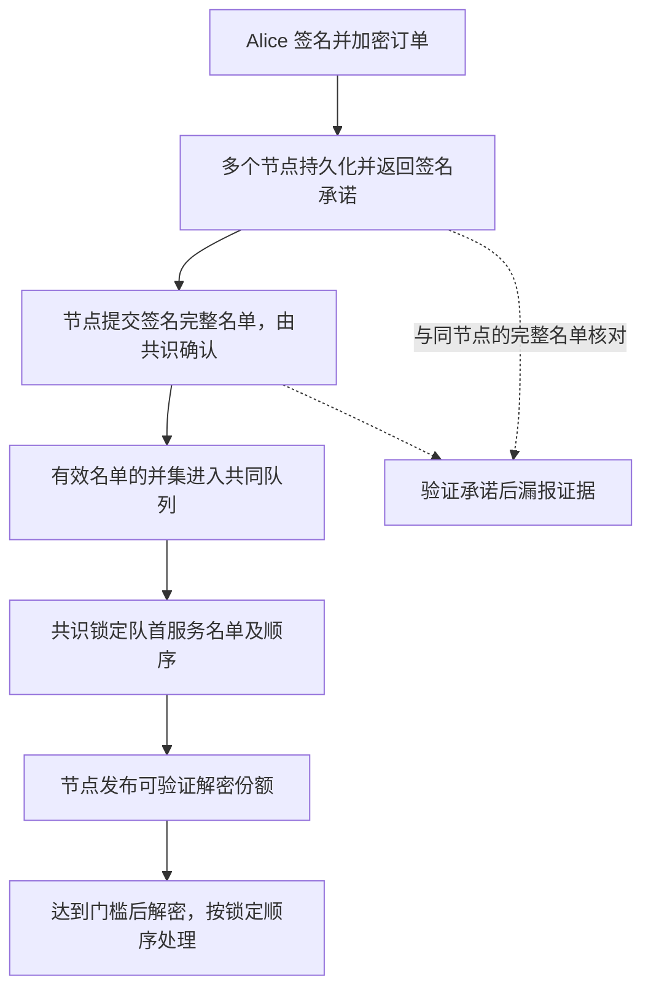

# pinomarket

[English](README.md) · **简体中文** · [实验报告](docs/experiments/2026-10-23/base-pair/BRIEF.zh-CN.md) · [协议说明](docs/LIVE_PROTOCOL.zh-CN.md) · [开销报告](docs/experiments/2026-10-25/performance/REPORT.zh-CN.md)

**让节点的承诺可检查，让订单的处理过程可重放。**

pinomarket 是一个用 Go 编写的加密订单与节点问责研究原型。我们用简化的预测市场，把用户提交订单、节点作出收录承诺、共同登记、锁定执行顺序、门限解密和市场处理连接起来，再让独立的 AI 节点尝试偏离规则，检查用户是否仍被收录、订单如何处理，以及是否留下可验证的证据。

**当前状态：可运行的本地多进程研究原型。** 已接入真实共识、签名和门限密码操作；尚未证明到达时间公平性，也不是可以托管真实资金的预测市场产品。

## 为什么叫 pinomarket？

**Pino** 来自 Pinocchio（匹诺曹），**market** 是市场。我们的节点叫“匹诺曹”：它们可以履约，也可以说出前后矛盾的话。

网络延迟造成的不同视图，本身不能证明节点撒谎。但如果一个节点先签名承诺收录某笔订单，后来又签署遗漏该订单的完整名单，就留下了可以核验的规则违约证据。这是我们想让人看见的“鼻子”。证据证明的是声明与义务之间的矛盾，不能直接证明节点的动机或首次收到交易的真实时间。

## 我们研究什么？

Alice 是现场观赛的球迷，比其他人更早知道赛果，于是发送一笔买单。Bob 尝试利用交易传播和处理过程争夺机会，节点也可能延迟接单或违背承诺。

我们分别检查三个问题：

- **内容暴露：** 在服务顺序确定前，节点能否看到订单的隐藏内容？
- **收录与履约：** 已经承诺的订单是否进入共同登记？节点漏报时留下什么证据？
- **处理结果：** 订单是否按已锁定的顺序处理，最终成交、部分成交还是被拒绝？

“收到了承诺”“进入登记”“锁定顺序”和“成功成交”是不同状态。当前协议不保证 Alice 一定最先执行、一定成交或保住信息优势。

## 一笔订单怎么走完？



| 阶段 | 做什么 | 需要分清的边界 |
|---|---|---|
| 加密提交 | 用户签名订单，用随机对称密钥加密正文，再用委员会公钥保护密钥 | 必要公开字段与发送时机仍可见 |
| 收录承诺 | 节点保存承诺，再返回签名；客户端收集不同成员的有效签名 | 承诺建立义务，不直接确定队列位置 |
| 共同登记 | 共识确认规定数量的名单，将其有效并集追加到共同队列 | 本轮内部仍用确定性占位规则 |
| 锁序与解密 | 先确认服务前缀，再发布并验证足够的解密份额 | 依赖门限与共识假设，用户无需再次揭示密钥 |
| 处理与问责 | 检查订单和市场状态，记录结果，核验签名矛盾 | 有证据不等于已处罚、补偿或恢复收录 |

当前同轮比较规则为 `owner → nonce → ciphertext ID`，它用于确定执行次序，**不代表先到先服务**。尚未实现孔多塞排序或中位数排序。

## 先跑起来：不需要模型账号

需要 Go 1.23 或以上、可用的 C 编译器，以及首次下载依赖的网络连接。在仓库根目录运行：

```sh
git clone https://github.com/LiamTang827/pinomarket.git
cd pinomarket
./scripts/network-demo.sh runs/my-first-demo normal
```

脚本编译程序、初始化五节点网络、启动独立进程并提交三笔订单，随后审计共识提交、区块重放、门限打开和市场账本，退出时停止自己启动的节点。输出目录必须是新的。

运行后先看：

- `runs/my-first-demo/audit.json`：审计结果。
- `runs/my-first-demo/*-receipt.json`：提交回执与承诺。
- `runs/my-first-demo/node*.log`：节点日志。

也可把 `normal` 换成 `offline`、`omission` 或 `withhold`，检查离线、名单遗漏或份额扣留场景。完整参数见[协议与操作说明](docs/LIVE_PROTOCOL.zh-CN.md)。运行目录含演示私钥，已通过 `.gitignore` 排除。

## 最新实验：承诺之后，节点仍会漏报吗？

2026-10-23，我们冻结协议源码和二进制，在八节点网络中让不同比例的节点由独立在线模型选择应用层动作。Alice 先广播，Bob 独立决定自己的买单。节点 agent 不交换私下策略，Bob 也没有控制节点的工具；正常协议传播与共识通信仍然存在。

参数为 `n=8, f=2, q=6, t=3`：最多两个故障节点的设定、六份收录签名/名单门槛、三份有效解密份额。该配置与五节点快速演示不同。

| 模型节点比例 | Alice 的有效承诺 | Alice 是否登记并处理 | 成交份额 | 签名漏报证据 |
|---|---:|---|---:|---:|
| 0% | 8 | 是 | 4 | 0 |
| 25% | 8 | 是 | 4 | 2 |
| 50%（有效补跑） | 8 | 是 | 4 | 4 |
| 100% | 8 | 否 | 未处理 | 8 |

在本次 25% 样本中，诚实名单和份额仍支持 Alice 完成处理；在 100% 样本中，虽然她持有八份承诺并留下八份漏报证据，却没有被登记。**证据与履约是两件需要分别评价的事。**

阅读结果时还需要注意：

- 50% 和 100% 超出 `f=2`，不能据此宣称容忍一半恶意节点。模型也不能修改共识投票或秘密份额。
- 本轮是受限对抗测试，没有节点经济效用，不能解释逐利节点为什么愿意撒谎。
- `alice` 与 `bob` 的固定身份使双方同轮登记时 Alice 在前，不能证明到达公平性。
- 每档仅一个预定在线样本；50% 因接口错误完整补跑一次，原失败记录保留。不能估计攻击成功率或吞吐上限。

[中文阶段报告](docs/experiments/2026-10-23/base-pair/BRIEF.zh-CN.md) · [详细报告](docs/experiments/2026-10-23/base-pair/REPORT.zh-CN.md) · [方法与复现](docs/BASE_PAIR_EXPERIMENT.zh-CN.md) · [结果数据](docs/experiments/2026-10-23/base-pair/results.json)

## 通信与计算复杂度：公式推导

设 $n$ 为节点数，$b$ 为本轮无冲突且全部处理的订单数，$L=O(\ell+\lambda)$ 为完整密文包长度。在每份承诺收据只向每个目标传播一次的模型下：

$$
C_{\text{直接,轮}}^{(1)}=O(n^2bL),\qquad
\overline C_{\text{直接}}^{(1)}=O(n^2L).
$$

这两式计算提交、返回承诺与一次完整收据传播。完整名单、份额、共识、重试及证据须另计。[完整公式推导](docs/COMPLEXITY.zh-CN.md)给出逐阶段公式、共识后端条件下的合并上界，以及用户加密、名单验证和门限打开的计算成本。

## 新增：通信与计算开销

已加入应用 HTTP 正文字节、共识发送包字节、节点 CPU/RSS、阶段延迟和 14 项实际 API 耗时统计。五节点、八节点各两次正常样本，每组六笔订单，全部处理并通过审计。原始计数、逐操作样本和失败记录均保留。

这是一轮有限负载测量，包含空块共识与重复传播；不等于吞吐上限或新增机制的净成本。参见[结果报告](docs/experiments/2026-10-25/performance/REPORT.zh-CN.md)和[统计口径与复现](docs/PERFORMANCE.zh-CN.md)。

```sh
python3 harness/performance_experiment.py \
  --binary "$PWD/bin/pinocchio" --out "$PWD/runs/performance-new" \
  --nodes 5,8 --orders 6 --repeats 2
```

## 两种运行模式与代码地图

| 目录或模式 | 用途 |
|---|---|
| `internal/live/` | 本机多进程协议、持久化状态、节点接口与审计 |
| `internal/consensus/` | CometBFT 共识接入 |
| `threshold/` | 基于 Shutter shlib 的门限密码与 DKG 计算 |
| `protocol/` | 单进程模拟的协议逻辑；不要与网络模式混淆 |
| `harness/` | Python 进程控制、受限模型动作、实验与记录 |
| `scripts/` | 构建和演示入口 |
| `docs/experiments/` | 整理后的报告、数据与核验记录 |

网络模式接入 CometBFT v0.38.26 和 Shutter shlib v0.1.19。默认五节点演示使用四份收录签名、三份有效解密份额。原有 v0.2 单进程模拟使用理想网络/密钥保管器，继续保留作控制基线：

```sh
./scripts/go.sh run ./cmd/pinocchio run -scenario normal -out runs/sim-first
./scripts/go.sh run ./cmd/pinocchio audit -file runs/sim-first/report.json
```

模拟命令详见 [v0.2 说明](docs/PROTOTYPE.zh-CN.md)。

### 测试与可选 AI 接入

```sh
./scripts/go.sh test ./cmd/... ./internal/... ./protocol/... ./threshold/...
./scripts/go.sh vet ./cmd/... ./internal/... ./protocol/... ./threshold/...
python3 -m unittest discover -s harness -p 'test_*.py'
```

AI 不参与密码算法或共识验证，只能在允许的应用层动作中决策。基础演示不需要 AI；在线实验需要单独配置模型连接，并消耗相应额度。参见 [Python harness](docs/PYTHON_HARNESS.zh-CN.md)、[节点 agent 实验](docs/AGENT_EXPERIMENT.zh-CN.md)及[可选模型连接](docs/CHATGPT_LOGIN.zh-CN.md)。登录凭据保存在本地忽略目录，不能提交到 GitHub。

## 当前边界与下一步

- 本机进程使用同一 OS 用户，不是相互隔离的安全域。初始化器会接触全部 DKG 输出份额，尚未实现跨主机独立认证的 DKG 仪式。
- 缺少共识票数或有效解密份额时可能停滞；足够多的份额持有者串谋仍可提前解密。
- 尚未实现 gas、押金、自动罚没、买方资金预留或外部结算。
- 尚未完成到达公平性证明、逐利排序实验或生产负载性能基准。

下一步优先明确节点的经济收益与可检查义务，再测试“为自身利益虚报接收先后”是否以及如何影响当前协议。完整待办见[路线图](ROADMAP.md)。

## 文档与来源

- **理解项目：** [设计范围](docs/SCOPE.md) · [开发报告](docs/DEVELOPMENT_REPORT.zh-CN.md)
- **阅读代码：** [Go 入门与维护](docs/LEARNING.zh-CN.md) · [GitHub 使用](docs/GITHUB_GUIDE.zh-CN.md)
- **历史与核验：** [更新记录](CHANGELOG.md) · [范围纠正](docs/SCOPE_CORRECTION.zh-CN.md) · [v0.3 验证](docs/validation-v03.json)
- **已有机制：** [Shutter + Primev 公开设计](https://ethresear.ch/t/threshold-encrypted-mempools-with-mev-commit-preconfirmations/23588)及 [primev-sequencer](https://github.com/shutter-network/primev-sequencer)提供加密交易与收录承诺的相关设计；本项目不将这两个机制本身作为原创贡献。
- **依赖：** [Shutter](https://github.com/shutter-network/shutter)提供门限密码组件；[CometBFT](https://github.com/cometbft/cometbft)提供共识引擎。
- **实验阅读参考：** [AOAB](https://gramoli.github.io/pubs/DSN24_AOAB_preprint.pdf)，未采用其排序协议。

项目名统一为 `pinomarket`，现有 `pinocchio` 命令和密码域标识保留以兼容实验。项目自身代码尚未选定许可证；第三方依赖保留各自许可证，见[归属说明](THIRD_PARTY.md)。
