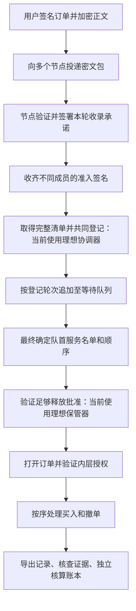

# pinomarket 开发报告与维护手册

## 当前版本：v0.3（2026-10-19）

真实多进程路径已经接通并通过本地功能测试：CometBFT 共识、Shutter 门限加密、持久化承诺、完整清单登记、有界队列、锁序后解密和签名遗漏证据。

- [完整协议、每步检查、运行命令和部署限制](LIVE_PROTOCOL.zh-CN.md)
- [English live protocol guide](LIVE_PROTOCOL.md)
- [本轮实际验证记录](validation-v03.json)

初始化仍是本地可信配置仪式，不是独立主机认证 DKG。默认回归测试通过 37 个顶层测试与 62 个子测试；真实五进程端到端测试另外开启并通过。已验证单节点离线进展、承诺签署者重启、追赶无重复及第二轮遗漏证据。正式性能实验仍待设计。

以下保留 v0.2 历史报告。其“理想协调器、理想保管器、没有真实网络”等描述仅适用于旧模拟器，不是当前 network 模式的状态。

---

# 历史记录：v0.2

记录日期：2026-10-19。项目状态：可以运行的 Go 协议研究模型，已完成本轮功能验证；真实分布式部署和门限加密仍待接入。

仓库：https://github.com/LiamTang827/pinomarket

本地目录：`/Users/tangliam/Projects/pinocchio-market`。本报告记录实际实现与后续计划，不将模拟组件写成已经完成的真实协议。

## 1. 我们要解决什么问题

预测市场中，Alice 在现场先知道赛果，提交一笔买入 YES 的订单。我们希望研究两类风险：订单内容提前公开后，其他参与者利用它调整自己的行为；节点已经作出明确承诺，却在后续清单或处理过程中违背承诺。

当前可实现的目标是：重放一笔订单的完整处理过程，并检查公开签名记录之间是否存在矛盾。我们不证明谁最早知道赛果，也不保证最先发送的人一定最先成交。余额、限价、库存、其他人的独立信息以及准入之前的拒绝，仍会影响结果。

“匹诺曹”的含义是让可证明的矛盾被看见。不同节点因延迟看到不同顺序，不等于说谎；节点沉默也不能直接证明其收到消息后故意隐瞒。

## 2. 当前系统模型和明确假设

默认有五个成员，最多一个故障成员；四个不同成员的承诺构成准入证书；三个不同成员的释放批准允许理想保管器打开订单。五、四、三是演示参数，不是不可修改的常数，也不代表已经实现共识。

配置检查包括：n≥3f+1、q≤n−f、2q>n+f、f<t≤n−f。其中 q 表示准入签名数量，t 在本实现里仅表示释放批准数量。满足这些数值关系仍不足以自动获得分布式协议的安全与活性。

本版具体采用以下模型：

- 一个进程，用虚拟时间调度消息；每个节点有独立的收件状态。
- 每个登记轮均能取得每个成员的完整清单；尚不处理节点崩溃导致清单永远缺失。
- 一个理想协调器完成共同登记与服务最终确认；它不是已经实现的拜占庭共识。
- 一个理想密钥保管器集中持有 AES 密钥；批准签名不是门限解密份额，没有分布式密钥生成或串谋保密保证。
- 市场只有一笔已有的 YES 卖单，初始锁定库存十份，每份六十分；Alice、Bob、Carol 默认各有一千分。
- 有节点每轮接单额度和每次服务容量；尚无全局队列总容量、费用、押金、惩罚、最大等待时间或链上结算。

## 3. 完整处理流程



### 3.1 用户签名、加密和发送

用户先用 Ed25519 签名订单及公开上下文，再使用每单随机的 256 位对称密钥进行 AES-GCM 加密。公开头部作为附加认证数据，内容可见，但不能与原密文任意拼接。最后对公开头部、随机数和密文核心签外层签名。

内层授权证明解密后的业务指令由用户签署；外层签名允许节点在不知道正文时验证提交身份和包完整性。订单标识不包含外层签名字节，同一包重复发送不会因为签名表示改变而自动获得新位置。

v0.2 的公开会话上下文只绑定公开策略及随机会话编号。v0.1 把含订单明文的完整配置散列进上下文，低熵订单可能遭到猜测核对；本轮已移除该做法。重放配置仍可含订单明文，但不会作为节点可见上下文的散列输入。

### 3.2 节点接收与承诺

节点验证外层签名和上下文，在窗口开放且本地名额未满时签署承诺：将这笔密文放入自己本轮的最终完整清单。收到重复包时不重复占名额或重复签署承诺。无效签名被拒绝，不使整个模拟退出。

收齐 q 份有效且身份不同的承诺表示满足登记资格；它不表示 Alice 已取得全局第几名。本版由模拟消息收集器汇总承诺；真实承诺传播、持久化及证书可用性机制尚未实现。

### 3.3 清单与共同登记

每个成员发布签署过的本轮完整清单。理想协调器为每成员选择一份清单，求并集和去重，仅纳入拥有足够有效承诺的订单。

同轮内部使用公开的用户、命令编号及密文摘要作确定性排序。这是暂用规则，受身份选择影响，不是先到先得或孔多塞公平排序。

若一个成员签署两份互相冲突的完整清单，系统保留冲突证据；理想协调器对清单的选择只是模拟行为，不能当作已经解决真实共识分叉。

### 3.4 队列和服务名单

本轮结果追加至已有队尾，后轮不能插到已经登记的订单之前。每次取队首至多 C 笔，绑定精确的有序名单摘要，并模拟最终确认。

服务证书与释放批准分别绑定会话、服务轮次和名单摘要。登记轮次与服务轮次可以不同。名单之外的等待订单不应被提前打开。

没有处理完所有已登记订单时，模拟器继续进行服务直到排空；这不是对真实网络故障下有限等待的证明。

### 3.5 打开、执行与完成

保管器验证锁序记录、固定成员公钥和足够释放批准，打开名单内订单，验证正文授权，再按同一顺序执行业务。

买入可能全部成交、部分成交、限价不满足、余额不足或无库存。只有卖家可以取消剩余库存，已经成交的份额不能撤回。每个用户和命令编号至多产生一次处理效果，业务失败也消耗该命令编号。

本版不在承诺时预留买入金额，所以无资金订单可以占用处理资源。费用、资金预锁和恶意垃圾订单成本仍待设计。

## 4. 哪些是真的，哪些是模拟的

已实际实现：Ed25519 签名和验证、AES-GCM 加密和认证、密文 ID、不同签署者计数、队列状态变更、固定价格成交和撤单、签名矛盾证据、离线核查与独立市场核算。

理想化组件：消息网络、共同登记、服务最终确认、门限释放。模拟器掌握全局状态；节点不会通过正常接收接口得到未打开订单正文，但进程之间没有安全隔离。

所有订单成功打开以后，报告仅公布这些已服务订单的 AES 密钥，供审计者检查密文、正文和内层签名的一致性。尚未服务订单的密钥及所有签名私钥不导出。理想保管器依旧集中掌握全部密钥，所以不能据此声称真实门限保密。

## 5. 代码模块与维护入口

- `protocol/types.go`：订单、配置、头部、承诺、证书和证据结构。
- `protocol/crypto.go`：签名订单的封装、AES-GCM、理想保管器、已服务订单的密钥打开记录。
- `protocol/simulator.go`：虚拟时间投递、内置场景、承诺收集、登记、队列和服务流程。
- `protocol/market.go`：余额、库存、成交和撤单执行。
- `protocol/report_audit.go`：不调用模拟器的公开材料核查。
- `protocol/market_audit.go`：不调用撮合执行器的独立业务结果与账本核算。
- `cmd/pinocchio/main.go`：运行、证据验证、报告核查与重放命令。
- `scenarios/normal.json`：可编辑的场景配置。
- `scripts/go.sh`：寻找系统或项目内 Go 工具链。
- `scripts/demo.sh`：批量运行十二个案例并逐一核查和重放。
- `.github/workflows/go.yml`：GitHub 自动测试配置；本报告记录本地结果，不把远程自动运行状态当作已确认结果。

## 6. v0.2 在 v0.1 上补了什么

1. 加入离线 `audit`，检查签名、准入证书、清单、登记并集、服务队首和释放批准。
2. 导出已服务订单的打开记录，使独立检查器能够认证解密内容。
3. 加入独立账本核算，逐项检查成交状态、数量、金额、每个账户余额、份额和剩余库存。
4. 加入重复投递、损坏签名和丢包场景，不把网络异常自动归为说谎。
5. 固定并复制保管器成员公钥，拒绝后续替换验证成员。
6. 限制窗口和延迟范围，避免整数溢出把极晚消息解释为负时间或提前消息。
7. 对密封输入作早期检查，非法私钥长度和不匹配身份返回错误，避免延后崩溃。
8. 核查日志内部的登记、锁序、解密和执行顺序，拒绝负时间和执行早于解密等矛盾。
9. 输出 `metrics.json`，区分处理完成、实际成交和业务失败。

这些是正确性和可维护性改进，不自动构成研究创新。

## 7. 三种验证分别说明什么

### verify：签名矛盾

只读取证据文件，检查给定成员公钥下的遗漏或冲突签名。它不读取仿真器的真实投递时间，也不证明现实身份。空证据文件验证通过不等于没有攻击。

### audit：公开材料的一致性

不重新运行模拟器，核对报告中的签名、证书、清单、登记与队列、已公布密钥、解密正文、事件阶段顺序以及指标，再独立核算市场状态。它还能发现报告已包含的签名材料中缺失的预期矛盾证据。

其身份根仍是报告提供的公钥；攻击者若整体替换身份和所有材料，不能单靠该文件证明原始来源。虚拟投递日志也不是现实物理时间的证明。对尚未打开订单，不能凭审计声称知道其正文。

### replay：语义重放

按配置与随机种子再次运行，比较语义事件、处理结果与最终市场状态。每次重新生成密码随机数，完整密文文件可以不同。语义重放不能代替公开签名核查；二者现在分别提供命令。

## 8. 已运行的案例和实际观察

- normal：三单登记、三单处理、三单成交，无违规证据。
- delay：各节点接收顺序不同，三单仍处理，无违规证据；同轮排序不是按真实接收时间计算。
- omission：node-1 承诺后发布空清单，三单仍经其他成员登记并处理，生成三份遗漏证据。
- refusal：node-1 不承诺，其余四成员仍足够，未生成说谎证据。
- equivocation：node-1 发布冲突清单，三单处理，生成两份冲突证据。
- late：Alice 在窗口关闭时才到达，未获登记；总计两单处理，没有据此定罪。
- capacity：每节点每轮只收一单，总计两单登记并处理，没有驱逐已登记订单。
- funds：三单完成处理，但 Alice 余额不足没有成交；“处理数”不能当作“成交数”。
- cancel：四单处理，卖家撤销剩余库存，后面的买单可能无库存；具体结果按已锁队列核对。
- duplicate：三单收到四十五次投递，其中三十次重复被忽略；仍只有三单登记和执行。
- corrupt：三次损坏签名被拒绝，其余四节点仍足够，三单处理，无说谎证据。
- drop：发往 node-1 的三次投递丢失，其余十二次到达，三单处理，无说谎证据。

这些是小规模功能性案例。没有估计真实攻击发生率、一般隐私程度、现实盈利或生产性能。

## 9. 本轮测试结果和证据

本轮本地验证：21 个顶层测试通过，62 个子测试通过，失败为零；`go vet` 通过。十二个 CLI 案例分别完成运行、离线审计和语义重放。

回归测试覆盖：不足与重复签名、证据篡改与跨上下文复用、公开上下文不含秘密订单散列、成员公钥替换、虚拟时间溢出、提前执行日志、错误释放密钥、缺失准入证书、缺失证据、队首重排、账本转错账户以及多种成交和撤单分支。

可复查的聚合记录保存在 `docs/validation-v02.json`；完整生成结果在本地忽略目录 `runs/`，不默认提交随机密文与日志。测试数量表示这批断言通过，不表示已经穷尽协议状态空间或完成安全证明。

## 10. 开发环境与常用命令

项目使用 Go 标准库，最低 Go 版本为 1.23。无需数据库、Docker、区块链节点或真实钱包。当前本机工具链放在 `.tools/go`，该目录被 Git 忽略；其他电脑需自行安装 Go。

```bash
cd /Users/tangliam/Projects/pinocchio-market
./scripts/go.sh test ./...
./scripts/go.sh vet ./...
./scripts/demo.sh runs/my-v02-suite
```

单独体验遗漏案例：

```bash
./scripts/go.sh run ./cmd/pinocchio run -scenario omission -out runs/my-omission
./scripts/go.sh run ./cmd/pinocchio verify -file runs/my-omission/evidence.json
./scripts/go.sh run ./cmd/pinocchio audit -file runs/my-omission/report.json
./scripts/go.sh run ./cmd/pinocchio replay -file runs/my-omission/report.json
```

每次使用新的输出目录，程序拒绝覆盖旧结果。报告包含供重放使用的场景明文，因此不是生产隐私日志。

输出含义：`report.json` 是完整材料；`evidence.json` 是签名矛盾；`events.jsonl` 是时间线；`metrics.json` 是功能计数。`executed` 表示业务已经得到结果，`filled_orders` 表示实际买入成交订单，`business_failures` 表示未成功的业务结果；`pending` 只计已经登记但尚未处理的订单，不包含准入失败的申请。

## 11. 怎样开始学习和维护 Go

先看 `Order` 的字段，再读 `Market.Execute`。用一句话描述输入条件和预期结果，再运行程序检查。熟悉后再看承诺、队列、密码和审计；第一阶段不要求独立编写并发网络。

想改买入量、限价、延迟或服务容量，先改 JSON 场景；想改成交规则，看 `market.go`，同时修改独立核算规则和相应测试。想改准入、队列或解密条件，应先写出新规则和反例，再修改实现，不能只调门限数字让失败消失。

每次小修改遵循：描述规则 → 预测结果 → 改少量代码或配置 → 跑相关测试 → 检查结果与差异 → 提交版本。代码和文档需要一起更新，尤其是从模拟组件切换真实实现时。

## 12. 当前不能承诺什么

没有真实网络故障容错、可靠广播、服务共识、密钥分发、真实解密份额、崩溃恢复、资源预付、惩罚执行、最终结算、全局容量界、同轮公平或墙钟期限保证。

同轮规则可能受身份选择影响；承诺之前的延迟仍难以定罪；公共身份和时机可能泄露信息。没有真实密码开销测试，虚拟毫秒数不能当作延迟测量结果。

若正文认证失败、解密材料不足或服务无法推进，当前原型还没有完整的恢复状态机。损坏外层签名被拒绝，不代表全部恶意密文攻击已得到处理。

## 13. 与已有工作的关系

门限加密、先承诺再公开、签名日志及违约检查都存在已有研究或实现。项目参考 Shutter＋Primev、Rolling Shutter、AOAB、PeerReview 和 ABIDES，后续采用代码时需核查许可证及归属。

当前差异研究集中在：承诺如何成为共同登记义务、等待队列与服务前保密如何连接、有限容量下能取得哪些违规证据。现有实现为研究提供可重放工具，没有确认协议新颖性或优于已有方案。

参考入口：

- https://github.com/shutter-network/primev-sequencer
- https://github.com/shutter-network/rolling-shutter
- https://github.com/abides-sim/abides
- https://gramoli.github.io/pubs/DSN24_AOAB_preprint.pdf
- https://www.sigops.org/s/conferences/sosp/2007/papers/sosp118-haeberlen.pdf

## 14. 下一步与验收条件

第一步由作者掌握已有代码：能解释普通买入、余额不足、承诺遗漏及其证据；能修改一个配置并预测结果。

第二步收紧协议规格：写清缺失清单、承诺容量条件、证书传播、重复请求、数据可用性和解密停滞如何处理。验收依据是明确规则及对应反例，不能只靠演示成功。

第三步实现真实多进程通信：分别保存身份与状态，加入重启和断连，保留同一套消息及审计规则。独立进程数量不构成共识保证。

第四步选择并接入共同确认及门限密码实例，再做真实计算、通信和等待成本对比；最后增加可视化。

不承诺完成日期或实验结论；每一步完成后更新本报告、路线图和对应测试记录。
