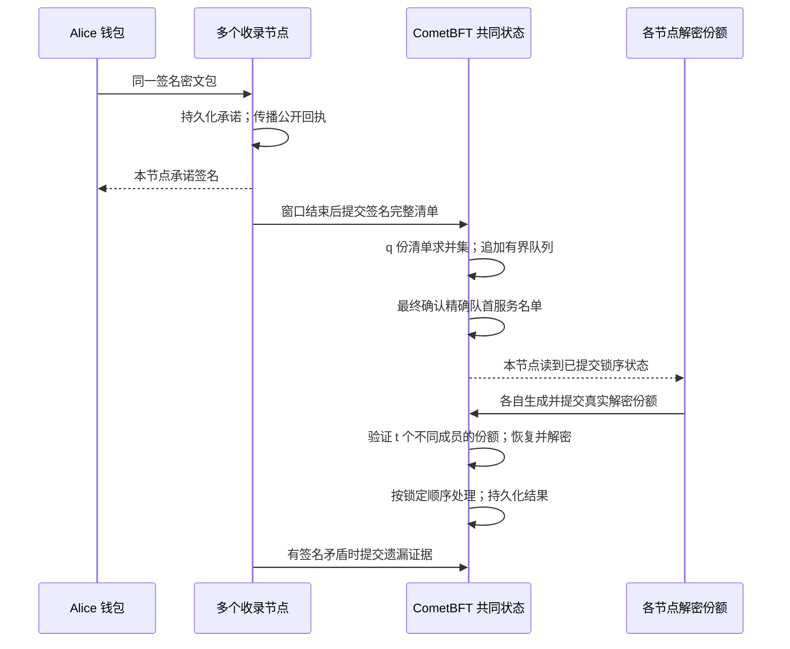

# pinomarket v0.3：可运行的本地多进程协议

记录日期：2026-10-19。代码入口：`internal/live/`。本文件说明 `network` 模式；原来的 `run` 模式仍是 v0.2 单进程模拟器。

## 1. 这版完成到哪里

五个节点现在是五个独立操作系统进程，通过实际 HTTP 和 CometBFT P2P 连接通信。每个节点有自己的签名私钥、门限私钥份额、共识数据库、签名状态和应用状态。共同登记和服务锁定由 CometBFT v0.38.26 确认；解密使用 Shutter shlib v0.1.19 的 BLS12-381 门限密码，不再用理想保管器代替。

已经接通的闭环是：用户加密提交 → 节点持久化承诺并传播 → 提交完整清单 → 共识登记 → 有界等待队列 → 共识锁定服务前缀 → 各节点提交可验证解密份额 → 按序执行 → 记录遗漏证据 → 核查真实共识签名、区块重放及账本。

这是供协议功能测试使用的本地研究实现。初始化器仍在一个进程内转发真实 DKG（分布式密钥生成）各参与方的消息，并生成各节点配置；因此初始化器能接触所有输出份额。运行时各节点只加载自己的份额，但同一电脑、同一操作系统用户不构成秘密的主机级隔离。独立主机上的认证 DKG、生产密钥托管和外部链结算尚未完成。

## 2. 需求与保护边界

Alice 先看到比赛结果，通过钱包提交买单。我们研究两个问题：在排序尚未确定时，监听者不应通过读取正文来针对该买单；节点已经签署收录承诺后，后续清单若违背承诺，应留下能核验的矛盾。

具体目标如下：

- 在少于 t 个解密成员串谋、诚实成员遵守释放规则的假设下，锁序之前隐藏订单方向、数量、限价等正文。公开用户身份、命令编号、密文大小和时机仍然可见。
- 在窗口、容量、诚实成员与网络进展假设下，取得足够承诺的同一笔有效密文可以进入本轮共同登记，不依赖 Alice 再上传整份证书或回来公开密钥。
- 已登记订单按轮追加队尾；每次只能服务精确队首前缀。后轮不能插队，解密后不能根据正文重新挑选或重排当前服务名单。
- 对同一成员“承诺收录”和“签署不含该单的完整清单”给出公开矛盾证据；不能仅凭沉默或接收顺序不同给节点定罪。

不保证 Alice 比所有独立知情者先成交，也不证明现实中谁先知道结果。买单仍可能余额不足、限价不合适或没有库存。没有实现同轮公平排序、gas 竞价、预锁资金、押金或自动罚没；没有给出绝对墙钟等待上限或新颖性证明。

## 3. 参与者、参数与容量

本地默认配置：

- 成员数 `n = 5`，容许故障数 `f = floor((n−1)/3) = 1`。
- 承诺与完整清单数量 `q = n−f = 4`。
- 解密门限 `t = 3`，满足 `f < t ≤ q`。
- 全局等待容量 `Qmax = 30`，单次服务容量 `C = 2`。
- 登记窗口为 30 个已提交区块；普通初始化最小提交间隔为 500ms，演示脚本设为 300ms。这些不是真实固定出块或等待期限保证。

同一批成员兼任收录节点、CometBFT 验证者和解密委员会成员，但分别使用收录签名密钥、共识验证者密钥和门限份额。四份承诺是收录义务的签名集合；三份解密份额是恢复某个密文解密能力的密码材料，两者含义不同。

本轮打开时，共识固定每节点接单额度：

```text
M = floor((Qmax − U) / n)
```

`U` 是当前未处理队列长度，包含已经锁定但尚未执行完的前缀。即使所有节点接收完全不重叠的订单，最多也只有 `nM ≤ Qmax−U` 笔新订单。额度向下取整会浪费少量容量，是当前简单实现的选择。`M=0` 时节点拒绝新增承诺，已有队列继续服务；下一轮再计算额度。

为控制消息大小，本版限定 4–10 个成员，`n ≤ Qmax ≤ 8n`、`1 ≤ C ≤ Qmax`。单密文包不超过 64KiB，共识事务不超过 1MiB。它们是本地原型的资源限制，不是协议适用规模的理论结论。历史区块、订单和证据仍持续积累；有界等待队列不等于有界总磁盘占用。

## 4. 从初始化到执行



### 4.1 初始化共同配置

初始化器生成成员身份、CometBFT 创世验证者集合、钱包，以及门限密码的公共配置与每节点份额。公共 `manifest.json` 包含公钥、网络会话、门限、容量和地址；其摘要作为上下文，绑定后续签名和密文，避免跨网络复用。

`node0.json` 等文件含各节点自己的秘密；`wallets/` 含演示钱包私钥。节点运行后保留自己的共识 WAL（预写日志）、防双签状态、应用快照和承诺日志。不要共享或提交这些文件。身份公钥及创世配置是外部信任起点，不能靠把整套公钥换掉后重新签名来证明是原网络。

### 4.2 用户签名并加密

`h` 是公开头部，包括协议域、网络上下文、登记轮、用户和唯一命令编号。`tx` 是订单，`sk_A` 是 Alice 的签名私钥，`k` 是这笔订单新生成的 32 字节随机 AES 密钥：

```text
σinner = Sign(sk_A, (h, tx))
ctx = AES-GCM.Encrypt(k, (tx, σinner), additional_data=h)
L = Hash(h, AES_nonce, ctx)
ck = ThresholdEncrypt(public_config, label=L, plaintext=k)
core = (h, AES_nonce, ctx, ck)
id = Hash(core)
σouter = Sign(sk_A, core)
E = (core, σouter)
```

`h` 作为附加认证数据参与认证，不被加密。内层签名授权真实订单，外层签名让节点在不知道正文时验证提交者和完整性。`ck` 在代码中还包含密码配置编号和新随机身份 nonce；绑定标签防止把别人的钥匙密文拼接到另一个用户或正文上。`id` 不含外层签名字节。

用户向多个节点发送同一个 `E`。同一包重发复用原始回执文件；不要重新加密同一个用户和命令编号，因为那会得到不同密文，可能被视为用户冲突提交。

### 4.3 节点先落盘，再返回承诺

节点检查用户外层签名、上下文、密文结构、标签绑定、当前本地已提交窗口及剩余额度；不提前知道买卖方向或检查隐藏数量对应的余额。

接受时签署 `(context, node, round, id)`，将密文和承诺写入本地持久化日志，成功后才返回 Alice。写入采用临时文件、同步和原子替换；重启后同一包返回同一份承诺。一个节点不会为同一用户和编号的两个不同包正常签约。

节点也向其他节点传播密文和公开承诺；其他节点可保存并核验证据材料。传播别人的承诺不等于本节点也承诺接单，不占用或替代本节点的收录义务。

Alice 收齐 `q` 个不同成员对同一上下文、轮次和 `id` 的有效签名，就有了收录承诺证书。此刻仍没有唯一的全局名次；成员履约不依赖 Alice 再回来上传证书。

### 4.4 完整清单与共同登记

共识高度到达窗口末尾后，节点停止新承诺，将自己的本轮记录封为一份签名完整清单。节点重启后也从已持久化承诺恢复该清单。清单含原密文及本节点承诺，其他验证者检查签名、结构、去重和固定额度。

清单通过真正的 CometBFT 共识提交。收齐 `q` 个不同成员的有效清单后，登记命令选取提交顺序中最先出现的 `q` 份，求并集并去重。对同一用户和编号出现多个不同包的冲突引用不登记；已经登记过的引用也不重复登记。其余按 `(owner, nonce, id)` 的确定性规则排列，追加到旧队尾。

取得 `q` 份承诺的诚实用户，其承诺成员集合与选中的 `q` 个清单成员至少重叠 `2q−n` 个，其中至少 `2q−n−f > 0` 个诚实成员。因此只要诚实成员履约，订单会出现在并集中。这个理由依赖用户没有冲突提交、清单与密文有效、容量预留和共识继续推进。

登记代码不要求并集中每笔单都先取得 `q` 份承诺；来自某份有效清单的未获足量回执订单也可能进入。`q` 份承诺提供足以保证收录的条件，不是独占登记资格的筛选条件。

当前同轮排序是可执行的暂用规则，身份选择可能影响位置；没有用接收时间、gas 或孔多塞多数关系排序。

### 4.5 锁定精确服务前缀

没有活动服务时，节点提出锁定当前队首最多 `C` 笔。状态机自己计算该前缀，拒绝跳过队首、重复服务编号和过期队首引用。锁标识绑定网络上下文、服务编号及精确有序名单。

锁事务真正提交后，节点才从自己的已提交状态看到释放条件。这个步骤使“已经看见内容再决定名单”无法通过诚实验证者的状态转换；等待队列其余订单仍保持加密。活动前缀直到执行完成才从队列移除，避免重复预留容量。

### 4.6 各节点分别提交解密份额

每个节点只用自己的门限私钥份额，给活动名单中的每笔 `ck` 生成解密份额。它签署绑定锁标识和完整份额批次的事务，并提交到共识；不向理想保管器投票，不获取其他节点私钥。

验证者检查提交者、份额成员索引、密文身份、密码配置和 BLS 配对关系，拒绝伪造、重复成员、错误密文及错误锁标识。对于每笔单，达到 `t` 个不同有效份额后，可组合得到该密文身份对应的解密能力，再恢复用户随机 AES 密钥 `k`。

这不重构长期委员会标量私钥。份额公布以后，任何人都能解密对应订单；保护目标是按协议时点公开，而不是永远保密。超过门限的串谋可以绕过诚实释放规则，不能由应用状态机阻止。

### 4.7 按序执行与重复保护

服务名单每笔都有足够份额后，提交绑定该活动锁的执行命令。每个验证者都独立组合份额、恢复 AES 密钥、验证 GCM 认证及内层签名，再按已经锁定的顺序执行业务；没有单独的中央解密执行器。

- 买入可能全部或部分成交，也可能限价不符、余额不足或没有库存。
- 只有卖家有权撤销剩余卖单库存；已成交份额不会撤回。
- 无法通过正文认证、解码或内层授权的订单记为 `invalid_encrypted_payload`，不产生买入效果，仍消耗本次处理位置。
- 份额不足时保持活动服务等待；本版不设置超时后跳过的后门。
- 登记时持久化 `(owner, nonce)` 的已用记录；开轮、登记、锁序和执行命令都绑定轮次或精确锁，跨轮重放不产生第二次效果。

执行结果、队列和市场余额进入应用快照，应用状态摘要由后续 CometBFT 已签区块头认证。完成处理不等于保证成交或获利。

## 5. 证据能证明什么

可提交的遗漏证据由同一节点的两份签名材料组成：它对该单作出的收录承诺，以及它签署的同轮完整清单；清单中不含该单。验证不需要相信模拟器宣称的真实到达时间。

证据通过状态机验证后保存。当前不执行押金扣除、链上罚没或赔偿，也不因节点没有清单就构造它的签名。缺少承诺、丢包、节点不响应和网络延迟分别属于其他可观察现象，不能自动当作签名矛盾。v0.2 中的清单双签场景仍留在模拟器中；v0.3 的自动证据提交目前只覆盖承诺遗漏。

## 6. 已实际完成的测试

### 自动单元与回归检查

`go test ./...`：37 个顶层测试、62 个子测试通过，零失败；3 个按环境门控或作为子进程入口的测试跳过。`go vet ./...` 通过。真实进程测试另行开启并已运行，不因默认跳过就当作没有测过。

涵盖真实门限解密的不同成员组合、不足门限、重复/错误份额、标签和密文篡改、DKG 投诉及恢复路径、共识适配、状态重放绑定、持久化重启和原模拟器回归。测试断言不是密码安全证明。

### 五进程端到端测试

`TestLiveNetworkProcessesRestartAndOmission` 已通过：

1. 启动五个实际验证进程，停止第五个；其余四个完成共识和三笔订单。
2. 在承诺后、清单提交前重启一个签署节点；同一密文返回相同持久化承诺。
3. Alice 买 4 份，Bob 和 Carol 各买 3 份，每份 60 分；最终分别付 240、180、180 分，卖家收到 600 分，库存归零。
4. 第五个节点重新启动并追上共同状态，没有第二次扣款或成交。
5. 第二轮让一个签过承诺的节点提交空清单，并停止另一节点，使该清单进入四份选择集合；生成并核验一份遗漏证据。
6. 第二轮订单因库存售完返回 `no_inventory`，属于正常业务结果；实际共识、队列和解密仍完成。
7. 两轮均核验真实区块提交签名、重放链上命令、重算门限打开和独立市场账本。

单独执行 `scripts/network-demo.sh ... offline` 也已通过：登记 3 单、处理 3 单、2 次服务、4 个区块提交签名，账本与上面三单一致。测试用时没有用作吞吐或延迟对比；尚未开展正式性能实验和故障范围穷举。机器可读结果见 `validation-v03.json`。

## 7. 一条命令运行

```bash
cd /Users/tangliam/Projects/pinocchio-market
./scripts/network-demo.sh runs/my-v03-test offline
```

需要 Go 1.23 或更新版本，以及 `blst` 所需的可用 C 编译器；当前本机已使用项目内 Go 1.27.2 编译通过。其他电脑首次构建会下载固定依赖，不再是只有标准库的项目。

脚本自动构建、初始化、启动五个后台进程、停止第五个、开轮、提交三单、等待处理、核查并停止自己启动的进程。不要重复使用同一输出目录；重新运行换一个名字。脚本占用本机 P2P 端口 `26656+10i`、RPC `26657+10i` 和应用端口 `28000+i`，其中 `i=0..4`；不要同时开两套默认端口网络。

其他案例：

```bash
./scripts/network-demo.sh runs/my-v03-normal normal
./scripts/network-demo.sh runs/my-v03-omission omission
./scripts/network-demo.sh runs/my-v03-withhold withhold
```

`omission` 让第一个节点提交空清单，并停止第五个；`withhold` 只让第一个节点不提交自己的解密份额，其他四个正常工作。这些脚本场景可运行；本次单独 CLI 验收跑的是 `offline`，遗漏及重启在端到端测试中验证，不混淆为所有脚本模式都逐一跑过。

输出目录里的 `audit.json` 是公开核查结果，`alice-receipt.json` 等是密文和收录签名，`node*.log` 是各实际进程日志。`processed` 是完成业务处理数量，`evidence` 是已验证签名矛盾数；零证据不证明没有攻击。私钥、门限份额和共识数据也位于运行目录中，整个目录不能直接上传公开。

## 8. 手动运行和故障操作

先构建并初始化：

```bash
./scripts/go.sh build -o bin/pinocchio ./cmd/pinocchio
bin/pinocchio network init -dir runs/manual-v03
```

开五个终端，分别运行以下命令之一（保持前台运行）：

```bash
bin/pinocchio network node -config runs/manual-v03/node0.json
bin/pinocchio network node -config runs/manual-v03/node1.json
bin/pinocchio network node -config runs/manual-v03/node2.json
bin/pinocchio network node -config runs/manual-v03/node3.json
bin/pinocchio network node -config runs/manual-v03/node4.json
```

第六个终端执行：

```bash
bin/pinocchio network ready -dir runs/manual-v03
bin/pinocchio network open -dir runs/manual-v03
bin/pinocchio network submit -dir runs/manual-v03 -owner alice -quantity 4 -nonce 0 -out runs/manual-v03/alice-receipt.json
bin/pinocchio network wait -dir runs/manual-v03 -processed 1
bin/pinocchio network status -dir runs/manual-v03
bin/pinocchio network audit -dir runs/manual-v03 -out runs/manual-v03/audit.json
```

节点终端 `Ctrl+C` 可正常停止；再次运行同一节点命令使用原目录恢复，不要重新 `init`，不要删除共识防双签状态。用户离线不阻止已接收订单完成解密；新轮新订单须使用新的命令编号。重发原包用 `network submit -dir ... -packet .../alice-receipt.json`，不新生成密文。

故障标志加在特定节点的启动命令后：`-refuse` 拒绝新承诺，`-omit-list` 故意遗漏，`-withhold-shares` 不释放本节点份额，`-delay-ms 500` 延迟接单 API。最后一项只模拟入口处理延迟，未模拟任意 P2P 拓扑、带宽限制或共识网络分区。

运行门控真实进程测试：

```bash
PINOCCHIO_LIVE_INTEGRATION=1 ./scripts/go.sh test ./internal/live -run '^TestLiveNetworkProcessesRestartAndOmission$' -count=1 -timeout=150s -v
```

默认使用测试端口 `34656+10i`、`34657+10i`、`35600+i`，不能并发运行两份同一测试。本次只验证特定故障与恢复路径，不能据此声称可容忍任意磁盘损坏、任意时刻掉电或多个拜占庭成员。

## 9. 怎样读代码

- `internal/live/types.go`：公共配置、密文包、内外签名、承诺、完整清单和签名命令。
- `threshold/`：真实门限加密、单参与方 DKG、份额验证及组合；上游归属见 `threshold/THIRD_PARTY.md`。
- `internal/consensus/`：CometBFT 配置和 ABCI++ 应用适配。共识投票与最终确认由上游引擎负责。
- `internal/live/node.go`：一个节点的 HTTP、承诺落盘、回执传播、清单封存和后台状态推进。
- `internal/live/state.go`：所有副本一致执行的规则；先读这一文件理解如何从登记走到处理。
- `internal/live/machine.go`：提交前后的状态隔离、应用快照与重启。
- `protocol/market.go`：沿用的简单市场，独立核算在 `protocol/market_audit.go`。
- `internal/live/audit.go`：读真实链、验证提交签名、重放状态机，再独立核对打开和账本。重放复用协议状态转换，因此不构成独立证明状态转换规则本身正确；业务核算另有独立实现。
- `internal/live/network_integration_test.go`：实际进程启动、停止、重启、第二轮遗漏和收尾。

维护时先修改一条明确规则并写出反例，再改相应状态转换及测试。不要直接改解密库公式；应用层的时点授权、绑定关系与密码库的数学正确性需要分别检查。

## 10. 接下来可以测什么

当前已具备继续测试完整处理路径的代码基础。正式实验前仍需与你和老师确认自变量、对照组和结论范围。可以逐步量化：节点数和故障数、订单负载、窗口和服务容量、份额发布延迟、入队/锁序/打开/执行延迟、通信与 CPU 开销、遗漏证据产生率。

尚待实现的独立研究与工程任务包括：跨主机认证 DKG 和密钥轮换、对等网络故障注入、同轮排序规则、费用及垃圾单成本、资金预锁、证据经济执行、状态裁剪与快照分发、外部链连接和用户界面。当前接口只接受回环地址，不应直接作为公网服务发布。

## 11. 与已有工作的关系

真实密码调用 Shutter 的公开库，共识调用 CometBFT，未宣称重新发明这些组件。pinomarket 当前实现的是把收录承诺、容量预留、完整清单登记、持久队列、锁序后解密和签名矛盾记录接成可测试状态机。是否构成新的协议贡献，仍需与 Shutter/Primev 等工作的精确威胁模型与性质逐项比较。跑通代码本身不能证明新颖性。

依赖版本和许可证入口见根目录 `THIRD_PARTY.md`；固定版本以 `go.mod`、`go.sum` 为准。
